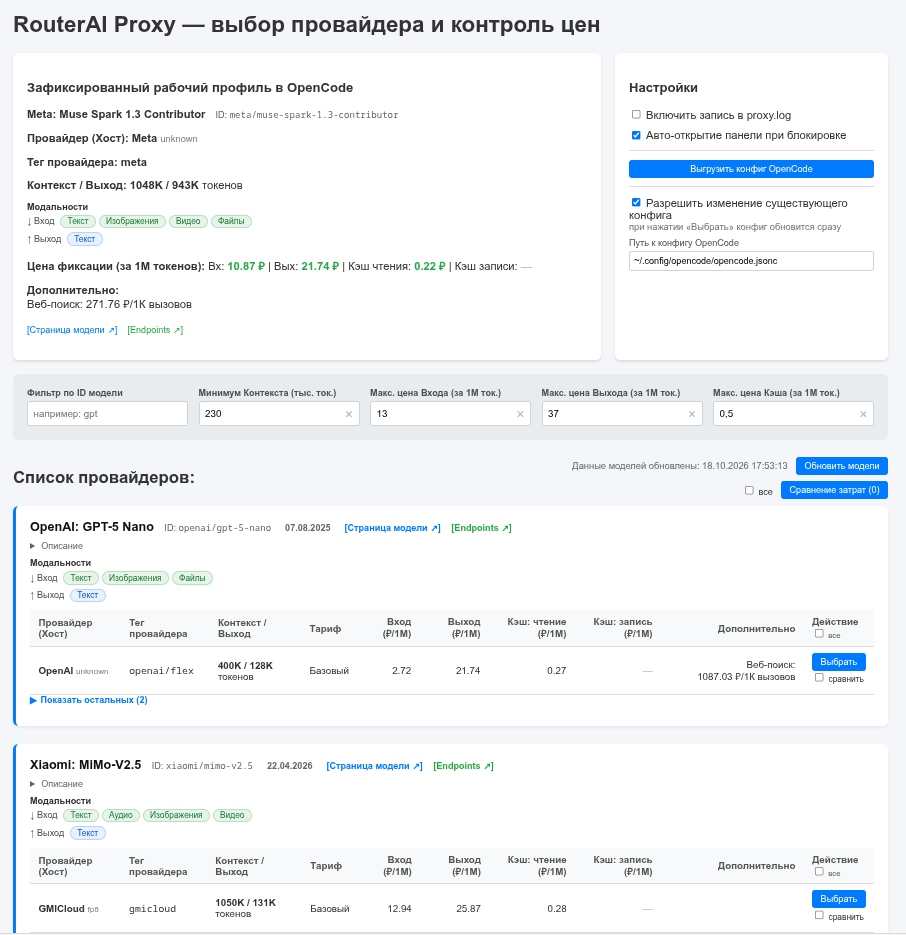
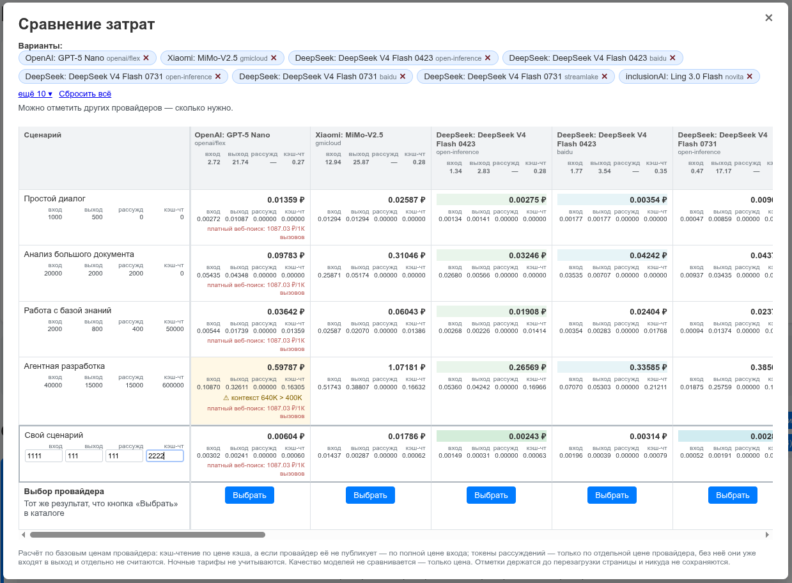

# RouterAI Proxy

**Локальный прокси между OpenCode и RouterAI: точный выбор провайдера для модели, фиксация цен и защита от молчаливого подорожания.**


---

## Какую проблему решает

RouterAI отдаёт одну и ту же модель через **десятки хостов с разными ценами** — один провайдер дешевле на входе, другой держит контекст побольше, третий ночью считает иначе. OpenCode выбирает из них любой, и вы не управляете этим выбором.

Хуже другое: **цена выбранного хоста может вырасти в любой момент**, и вы узнаете об этом только из счёта.

RouterAI Proxy ставит между OpenCode и RouterAI свой слой, где вы один раз и явно выбираете провайдера — а прокси следит, чтобы условия не изменились за вашей спиной.

## Возможности

- **Точно выбранный провайдер** — запросы уходят только на него, с `allow_fallbacks=false`. Молчаливого переключения на другой хост не будет
- **Фиксация цен** — в момент выбора текущие цены становятся эталоном
- **Фоновый монитор** — цена выросла → запросы блокируются с внятной причиной; при активной блокировке проверка цен полностью приостановлена (лишних обращений к RouterAI нет)
- **Веб-панель** — каталог 560+ моделей, фильтры по контексту, ценам входа/выхода/кэша и ID модели, «Показать остальных (N)»
- **Дополнительные тарифы** с русскими названиями и корректными единицами: `Запрос: 4.42 ₽/1 запрос`, `Веб-поиск: 1545.27 ₽/1К вызовов`
- **Кэш каталога** с датой последнего обновления — панель открывается мгновенно
- **Точечная правка `opencode.jsonc`** — если конфиг уже настроен, меняются только порт и лимиты; комментарии, оформление и чужие провайдеры не затрагиваются, перед первой правкой создаётся `.bak`
- **Настраиваемый порт** с авто-освобождением при перезапуске (Linux — `/proc` + сигналы, Windows — `netstat` + `taskkill`)
- **Ошибки в формате OpenAI** со ссылкой на панель выбора — OpenCode показывает их как есть
- **Только стандартная библиотека Python 3.6+** — `pip install` не нужен

## Панель управления



*Слева — зафиксированный профиль и фильтры провайдеров, справа — настройки: логирование, авто-открытие, выгрузка и обновление конфига OpenCode.*

### Сравнение затрат



*Калькулятор: сценарии в токенах, стоимость по каждому провайдеру с разбивкой, предупреждения о лимитах контекста и выхода. Формулы и поведение при неподдерживаемых позициях — в [руководстве](USER_GUIDE.md#сравнение-затрат).*

## Как это работает

```
        ┌─────────────────┐
        │     OpenCode    │
        └────────┬────────┘
                 │  baseURL: http://127.0.0.1:5000/v1
                 ▼
        ┌─────────────────┐      цена выросла?
        │  RouterAI Proxy │─────▶ блокировка + ссылка
        │    порт 5000    │      на панель выбора
        └────────┬────────┘
                 │  allow_fallbacks=false
                 ▼
      ┌───────────────────────────┐
      │  выбранный провайдер       │
      │  RouterAI (например, Baidu)│
      └───────────────────────────┘
```

Монитор цен работает в фоне каждые 10 минут (настраивается) и сравнивает актуальные цены выбранного провайдера с зафиксированными.

## Быстрый старт

```bash
git clone https://github.com/i-voron/routerai-proxy.git
cd routerai-proxy
python3 proxy.py
```

1. На вопрос `Открыть страницу управления в браузере? (Y/n):` нажмите `Y` или `Enter` (либо откройте http://127.0.0.1:5000 вручную)
2. Откройте `proxy_settings.json` (создаётся при первом запуске) и вставьте свой ключ с [routerai.ru](https://routerai.ru) в поле `api_key`. Перезапуск не нужен
3. Нажмите **«Обновить модели»** — каталог загрузится в кэш (~6 секунд)
4. Найдите модель, при необходимости отфильтруйте провайдеров по цене и нажмите **«Выбрать»**
5. В блоке **«Настройки»** нажмите **«Выгрузить конфиг OpenCode»** — в папке скрипта появится `opencode.jsonc`
6. Скопируйте конфиг и работайте:
   ```bash
   cp opencode.jsonc ~/.config/opencode/opencode.jsonc
   ```

Всё — запросы OpenCode пойдут через выбранного провайдера.

## Настройка

Все параметры живут в `proxy_settings.json` (в репозитории его нет — только `proxy_settings.example.json`). Скопируйте шаблон или доверьтесь значениям по умолчанию, которые скрипт создаёт сам при первом запуске.

| Параметр | По умолчанию | Смысл |
|----------|--------------|-------|
| `api_key` | — | ключ RouterAI |
| `port` | `5000` | порт панели и прокси |
| `check_interval_sec` | `600` | интервал проверки цен |
| `logging_enabled` | `true` | писать `proxy.log` |
| `auto_open_on_block` | `false` | открывать панель при блокировке |
| `filter_*` / `filter_model_id` | пусто | фильтры каталога |
| `opencode_config_path` | пусто | путь к существующему конфигу OpenCode |
| `opencode_config_allow_replace` | `false` | разрешить правку существующего конфига |

Остальные поля (`selected_model`, `frozen_prices`, `is_blocked`, ...) скрипт заполняет сам.

## Структура проекта

| Файл | Назначение |
|------|-----------|
| `proxy.py` | логика: настройки, монитор цен, HTTP-обработчики |
| `templates/panel.html` | панель управления: HTML, стили и скрипты |
| `tests/test_core.py` | тесты чистых функций |
| `docs/screenshot.png` | скриншот панели |
| `docs/screenshot2.png` | скриншот сравнения затрат |
| `SETUP.md` | подробная инструкция по настройке и запуску |
| `USER_GUIDE.md` | руководство пользователя и FAQ |
| `proxy_settings.example.json` | шаблон настроек без секретов |

При работе скрипт создаёт рядом с собой: `proxy_settings.json` (с вашим ключом), `proxy.log`, `catalog_cache.json`, `opencode.jsonc`. Всё это перечислено в `.gitignore` — в репозиторий не попадёт.

## Windows

Тот же `python3 proxy.py` (или `python proxy.py`) из PowerShell или cmd. Порт освобождается через `netstat` + `taskkill`, автооткрытие браузера работает. Подробности — в `SETUP.md`, раздел 7.

## Документация

- **[SETUP.md](SETUP.md)** — установка, параметры конфига, эндпоинты, автозапуск, Linux и Windows
- **[USER_GUIDE.md](USER_GUIDE.md)** — как пользоваться панелью, фильтрами, блокировкой и конфигом OpenCode, в том числе [как считается стоимость](USER_GUIDE.md#сравнение-затрат) и что происходит с неподдерживаемыми позициями

## Известные ограничения

- Поддержан только **RouterAI** (`routerai.ru`)
- Конфиг OpenCode подключается копированием файла, а не симлинком
- Ключ RouterAI хранится локально в `proxy_settings.json` — этот файл в `.gitignore`
- Веб-панель рассчитана на локальный `127.0.0.1`, наружу не открывается

## Лицензия

[MIT](LICENSE)
